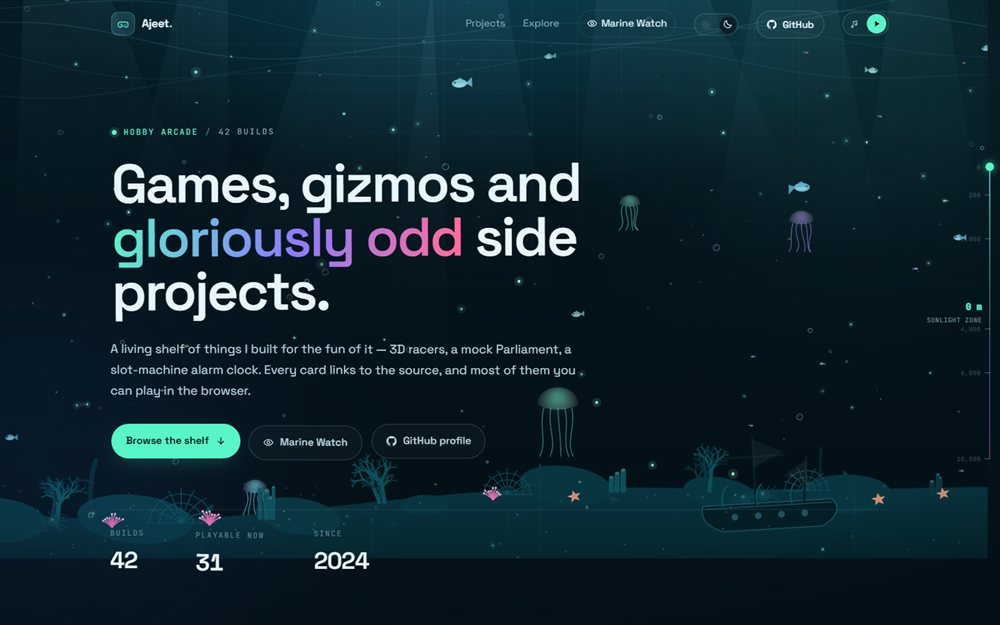

# Hobby Arcade — a self-updating project shelf

**[Open the live site](https://ajeet-iitk.github.io/SelfProjects/)**




A static portfolio page for GitHub hobby projects, wrapped in an interactive underwater
world. Point it at a GitHub account and it pulls in every relevant public repository
automatically — no per-repo edits needed — while still letting you feature and describe your
favourites by hand.

No framework. No build step. No dependencies. Plain HTML, CSS and JS, ready for GitHub Pages.

---

## The underwater scene

The background is a single canvas that renders the whole reef:

- **God rays, marine snow and rising bubbles** drifting through the water.
- **Bioluminescent plankton** that drift on the current and scatter away from the pointer,
  plus a soft caustic shimmer near the surface.
- **Schools of fish** across three depth layers, plus jellyfish and the occasional manta ray.
- **Coral, kelp, starfish, urchins, anemones and a sunken ship** along the sea floor.
- **Deep-sea visitors** that join as you scroll: a turtle, then sharks, a whale and glowing
  anglerfish. Each species enters at its own scroll depth, and going back up lets them swim
  away again.
- **Scuba-diver easter eggs** near the top of the page: a welder patching a floating card, a
  mechanic tightening a drifting gear and a swimmer checking on the fish. They fade out as
  soon as you scroll away from the hero, so they never follow you down the page.
- **Cursor ripples** — moving the pointer leaves expanding rings, and clicking makes a
  bigger splash with a small burst of bubbles.
- **Creatures that notice the pointer** — small fish scatter, sharks turn and trail your
  cursor, turtles dart away, whales ease toward your depth and an anglerfish leans its lure
  toward you. Clicking startles anything nearby.
- **Two palettes:** the day/night toggle now switches between a sunlit shallow reef and a
  deep, bioluminescent sea. Scrolling down deepens the water in both.
- **A floating interface** — headings, copy, buttons, stats, chips, tiles and project cards
  bob gently in the current and lean away from the pointer, so the whole page feels
  suspended in water.
- **A fish favicon** (`assets/favicon.svg`, plus a 180 px Apple touch icon) in the same
  glowing deep-teal style.

The scene pauses when the tab is hidden and draws a single static frame when the visitor
prefers reduced motion (ripples, pointer reactions and the floating interface are disabled
in that case).

## Background music

The player lives in the navbar as a compact pill and stays collapsed until you use it. Hover,
focus or click the note button to open a small panel with play/pause, mute, seek and volume.
It closes on Escape, on an outside click, or after a few seconds idle. Volume, mute and
on/off state persist between visits, and the track is `assets/audio/tu-mil-jaaye-king.mp3`.

Music is on by default. Browsers block audible autoplay before the first interaction, so if
the initial attempt is refused the player starts automatically on your first click, tap or
keypress anywhere outside the player controls.

---

## Files

```
portfolio/
├── index.html                  the page
├── .nojekyll                   tells GitHub Pages to serve files as-is
├── assets/
│   ├── css/style.css           all styling
│   ├── audio/                  background track
│   ├── favicon.svg             fish favicon (also linked from index.html)
│   ├── favicon-180.png         Apple touch icon
│   └── js/
│       ├── projects.js         curated projects + site config
│       ├── app.js              rendering, GitHub discovery, filters, lightbox
│       ├── background.js       underwater canvas scene, creatures + ripples
│       ├── player.js           navbar music player
│       ├── float.js            floating interface (bob + pointer reactions)
│       └── theme.js            reef / deep-sea theme toggle
├── thumbnails/                 ← drop screenshots here
│   └── README.md               naming rules
├── tools/
│   └── make-thumbnail.ps1      optional: auto-capture a thumbnail with Chrome
└── README.md                   this file
```

---

## Automatic repository discovery

On load the page requests the account's public repository list, 100 per page, and keeps
paging until GitHub runs out (up to 5 pages / 500 repositories):

```
https://api.github.com/users/<owner>/repos?per_page=100&page=1&sort=updated
```

Every repository that is public, not a fork, not archived and not empty is added to the
shelf automatically, newest-pushed first among the non-featured cards. Curated entries in
`projects.js` are always kept and take priority; their metadata comes from the same list.
The list is cached in `localStorage` for `cacheHours` (12 hours by default), storing only the
handful of fields the cards need so even a large account stays well inside the storage quota.
Paging stops early on a 403/429 rate-limit response and falls back to the cached list.

Discovery deliberately skips:

- forks and archived repositories
- empty repositories (`size: 0`)
- the profile repo (`<owner>/<owner>`), `SelfProjects`, and `.github`
- any name listed in `exclude`

Configure it in `assets/js/projects.js`:

```js
exclude: [],            // e.g. ["old-experiment", "scratch"]
maxAutoProjects: 300,   // safety cap; curated entries always show
```

Thumbnails for discovered repos are lazy-loaded a couple at a time as their cards approach
the viewport, which keeps GitHub's image service from rate-limiting the page. GitHub's
plain auto-generated preview card (the near-white 2:1 image with just the repo name) is
detected and skipped in favour of the generated gradient tile, while real custom social
previews are kept. Cards without a preview fall back to the themed gradient tile.

## Adding or featuring a project

Open `assets/js/projects.js`. Curating is optional now — anything public appears on its own —
but a curated entry lets you control the title, pitch, tags, type, featured order, demo link
and thumbnail. The shortest possible entry is just the repo:

```js
"Ajeet-iitk/MyNewGame",
```

That is enough. The card is built from the repo name, and description, language, stars,
topics and the GitHub Pages URL are pulled from the GitHub API at load time.

To control the copy, use the long form:

```js
{
  repo: "Ajeet-iitk/MyNewGame",     // required: "owner/repo" or a full github.com URL
  title: "My New Game",             // optional
  blurb: "One or two lines of pitch.", // optional — falls back to GitHub's description
  tags: ["three.js", "arcade"],     // optional — used by the tag filters
  type: "game",                     // game | web | app | experiment
  featured: true,                   // optional — pins the card to the front
  demo: "https://...",              // optional — otherwise auto-detected
  thumb: "thumbnails/custom.jpg",   // optional — otherwise auto-detected
  year: 2026,                       // optional
  skipOg: false                     // optional — set true to skip GitHub's preview image
}
```

Everything is optional except `repo`. Order in the file does not matter: sorting is done at runtime.

### How the live "Play" link is found

1. `demo` in `projects.js`, if set.
2. The repo's **Homepage** field on GitHub.
3. If the repo has **GitHub Pages** enabled, `https://<owner>.github.io/<repo>/`.

If none of those exist, the card simply shows **Code** only — nothing breaks.

> **Single-file games:** GitHub Pages serves `index.html` at the repo root. If your game is
> `my-game.html`, either rename it to `index.html`, or add a tiny `index.html` that redirects:
>
> ```html
> <meta http-equiv="refresh" content="0; url=my-game.html">
> ```

---

## Thumbnails

Put screenshots in `thumbnails/`. Naming is automatic — no code changes:

```
thumbnails/indian-parliament.jpg     ← kebab-case of the repo name  (preferred)
thumbnails/IndianParliament.jpg      ← exact repo name also works
thumbnails/indianparliament.jpg      ← lower-case repo name also works
```

Supported: `.jpg` (smallest, preferred), `.png`, `.webp`, `.gif`.

**Recommended:** 1280 × 800 px (16:10), JPG quality ~85, under 250 KB. The card shows a
16:10 crop anchored to the top, and clicking opens the full image in a lightbox.

If no file is found, the card tries GitHub's generated repo preview, then falls back to a
gradient tile with the project's initials. So a missing screenshot never looks broken.

### Auto-capture a thumbnail

`tools/make-thumbnail.ps1` drives headless Chrome. Requires Chrome or Edge installed:

```powershell
# from the portfolio folder
powershell -ExecutionPolicy Bypass -File tools/make-thumbnail.ps1 `
  -Url "https://ajeet-iitk.github.io/MyNewGame/" -Name "my-new-game"
```

It writes `thumbnails/my-new-game.jpg` at 1280 × 800. For a local file:

```powershell
powershell -ExecutionPolicy Bypass -File tools/make-thumbnail.ps1 `
  -Url "file:///C:/path/to/game.html" -Name "my-new-game"
```

---

## Run it locally

Just double-click `index.html` — it works from `file://` because the project list is a
plain JS file, not a `fetch()`ed JSON file.

Or serve it, which matches GitHub Pages more closely:

```powershell
python -m http.server 8080
# then open http://localhost:8080
```

The GitHub API needs an internet connection. Without it, the curated cards still render from
`projects.js`; automatic discovery simply waits for the next online visit.

---

## Deploy to GitHub Pages

### Option A — user site (`https://ajeet-iitk.github.io/`)

1. Create a repo named exactly **`Ajeet-iitk.github.io`**.
2. Copy the *contents* of this `portfolio/` folder to the repo root.
3. `git add . && git commit -m "Add portfolio" && git push`
4. Settings → Pages → Source: **Deploy from a branch** → Branch: `main`, Folder: `/ (root)`.

### Option B — project site (`https://ajeet-iitk.github.io/portfolio/`)

Same steps with any repo name (e.g. `portfolio`). All paths in the site are relative, so it
works from a subfolder without changes.

First deploy can take a minute. A `.nojekyll` file is included to stop Jekyll from
processing the folder.

---

## Notes

- **API rate limit:** anonymous GitHub API calls are limited to 60 per hour per visitor IP.
  Discovery uses the paginated list endpoint (100 repositories per request, cached for 12
  hours), not one request per repository, so the limit is rarely a concern. Curated metadata
  is filled from that same list.
- **Caching:** the repository list and thumbnails are cached in `localStorage` / the browser
  respectively; screenshot files are served as normal static assets.
- **Accessibility:** keyboard navigable, visible focus rings, skip link, lightbox supports
  `Esc` / `←` / `→`, and all motion respects `prefers-reduced-motion`.
- **Search shortcut:** press `/` anywhere to focus the search box.
- **Filters:** category chips plus the 12 most common tags are generated automatically from
  the curated and discovered repos — no configuration needed.
- **No analytics, no trackers, no cookies.**

## Customising the look

Colours, spacing and type live in `:root` at the top of `assets/css/style.css`:

```css
--mint: #58f5c8;    /* primary accent */
--violet: #8b7cff;  /* gradient mid-point */
--pink: #ff6b9d;    /* gradient end */
--bg:   #04121a;    /* deep-sea page background */
```

Card accents cycle through `ACCENTS` in `assets/js/app.js`. The reef palettes (fish, coral,
wreck, ripples, deep-sea creatures, plankton, anemones) live in `PALETTES` at the top of
`assets/js/background.js`. The scroll depths at which each deep-sea species appears are set in
`DEEP_SPAWN_AT`, just below `makeBubble`. The floating interface is tuned with `GROUPS`
(amplitude, rotation, pointer push and radius) at the top of `assets/js/float.js`. The hero
copy and the "How this shelf works" section are plain HTML in `index.html`.
